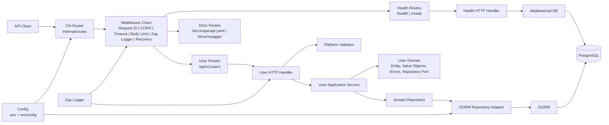
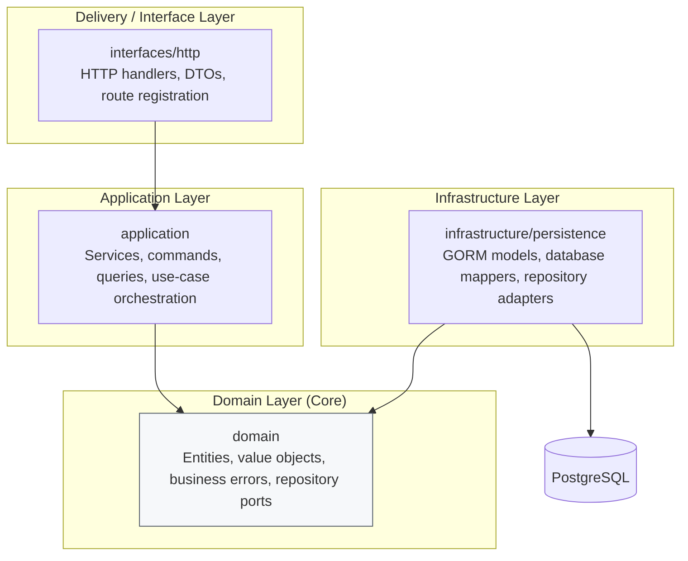
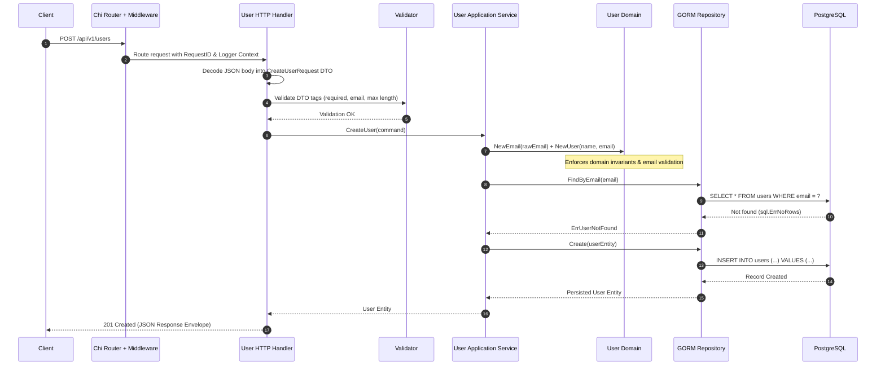
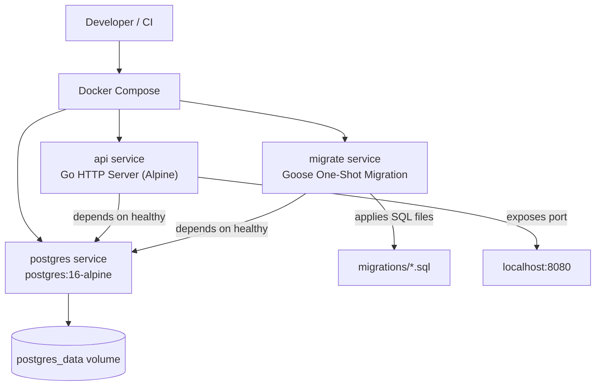
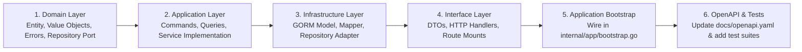

# DDD REST API

A production-grade Go REST API architected with **Domain-Driven Design (DDD)** and **Clean / Hexagonal Architecture** principles. Built for maintainability, testability, and operational resilience under real-world workloads.

---

## Highlights & Engineering Principles

- **Domain-Driven Design (DDD)**: Explicit boundary separation between delivery interfaces, application use-cases, core domain rules, and infrastructure persistence adapters.
- **Pure Domain Core**: Domain entities, value objects, and repository ports maintain zero external dependencies on frameworks, databases, or transport mechanisms.
- **Robust Delivery Layer**: HTTP routing powered by [Chi v5](https://github.com/go-chi/chi) with centralized DTO validation, structured error mapping, and standardized JSON response envelopes.
- **Enterprise Middleware**: Request ID propagation, structured [Zap](https://github.com/uber-go/zap) logging, panic recovery, context timeouts, CORS policies, security headers, and request body size limits.
- **PostgreSQL & GORM**: Connection-pooled PostgreSQL integration with repository patterns and transactional isolation.
- **Database Migrations**: Version-controlled, idempotent schema migrations managed via [Goose](https://github.com/pressly/goose).
- **Interactive Documentation**: Embedded OpenAPI 3.0 specification and Swagger UI served directly by the application runtime.
- **Production Containerization**: Multi-stage Docker build producing a minimal Alpine binary running as an unprivileged user with read-only root filesystems, dropped capabilities (`ALL`), and explicit healthchecks.
- **Comprehensive Testing**: Unit, handler (`httptest`), and end-to-end integration tests powered by [testcontainers-go](https://github.com/testcontainers/testcontainers-go).

---

## Tech Stack

| Component | Technology | Rationale |
| :--- | :--- | :--- |
| **Language** | Go 1.25 | High-performance, concurrent, statically typed systems language. |
| **HTTP Router** | Chi v5 | Lightweight, idiomatic, `net/http` compatible HTTP routing. |
| **ORM / Persistence** | GORM v1.30 / PostgreSQL 16 | Ergonomic query generation paired with robust relational persistence. |
| **Logging** | Uber Zap | Structured, leveled, zero-allocation logging for production observability. |
| **Schema Migrations**| Goose v3 | Idempotent, trackable raw SQL schema migrations. |
| **Validation** | go-playground/validator v10 | Declarative struct-tag validation at the DTO ingress boundary. |
| **Configuration** | envconfig + godotenv | Strict Twelve-Factor 12-factor typed environment configuration. |
| **API Documentation**| OpenAPI 3.0 + Swagger UI | Contract-first interactive documentation. |
| **Containerization** | Docker & Docker Compose | Repeatable local environments and hardened deployment images. |
| **Testing** | `testing`, `httptest`, `testcontainers-go` | Unit tests, mockless integration tests with ephemeral Postgres containers. |
| **Code Quality** | golangci-lint & pre-commit | Static analysis, code formatting, and automated quality gates. |

---

## Quick Start

### Using Docker Compose (Recommended)

Start PostgreSQL, automatically apply SQL migrations, and boot the API service:

```bash
cp .env.example .env
make docker-init
```

Verify service readiness:

```bash
curl http://localhost:8080/health
curl http://localhost:8080/ready
```

Interactive Swagger documentation is available at:
- **Swagger UI**: `http://localhost:8080/docs/swagger`
- **Raw OpenAPI Spec**: `http://localhost:8080/docs/openapi.yaml`

---

## Table of Contents

- [Architecture Overview](#architecture-overview)
- [Runtime Architecture](#runtime-architecture)
- [DDD Layer Dependencies](#ddd-layer-dependencies)
- [Request Lifecycle](#request-lifecycle)
- [Docker Architecture](#docker-architecture)
- [Repository Layout](#repository-layout)
- [Local Development](#local-development)
- [API Routes & Examples](#api-routes--examples)
- [Configuration Reference](#configuration-reference)
- [Database Migrations](#database-migrations)
- [Testing & Quality Assurance](#testing--quality-assurance)
- [Extending Bounded Contexts](#extending-bounded-contexts)
- [Production Hardening](#production-hardening)

---

## Architecture Overview

```text
cmd/api                Application entrypoint & dependency orchestration
internal/app           Server lifecycle, graceful shutdown, dependency wiring
internal/config        Typed environment configuration and validation
internal/routes        Global router, middleware chain, documentation routes
internal/platform      Cross-cutting infrastructure (database, logger, middleware, validator)
internal/modules       Domain-Driven Design bounded contexts (user, health)
migrations             Goose versioned SQL migrations
docs                   OpenAPI/Swagger schemas and documentation assets
scripts                Operational and automation shell scripts
tests/integration      Integration tests executed against real containerized PostgreSQL
```

### Bounded Contexts

1. **`health`**: Liveness and readiness probes with real-time PostgreSQL database ping verification.
2. **`user`**: Full reference bounded context showcasing DTO ingress, command/query separation, domain value objects with invariants, repository ports, and GORM persistence adapters.

---

## Runtime Architecture



---

## DDD Layer Dependencies

The dependency rule strictly points inward. Delivery and infrastructure layers depend on domain contracts; domain code never depends on external frameworks.



```text
interfaces/http -> application -> domain
infrastructure  -> domain
```

---

## Request Lifecycle

Example: Creating a new user via `POST /api/v1/users`



---

## Docker Architecture



---

## Repository Layout

```text
.
├── .github/workflows/              # Continuous Integration (lint, test, build)
├── cmd/
│   └── api/
│       └── main.go                 # Application entrypoint & signal handling
├── docs/
│   ├── openapi.yaml                # OpenAPI 3.0 specification
│   └── swagger/                    # Embedded Swagger UI assets
├── internal/
│   ├── app/
│   │   ├── bootstrap.go            # Wires dependencies and builds Chi router
│   │   └── server.go               # HTTP server lifecycle and graceful shutdown
│   ├── config/
│   │   └── config.go               # Typed environment configuration via envconfig
│   ├── routes/
│   │   └── routes.go               # Router assembly, middleware, and route mounting
│   ├── platform/
│   │   ├── database/               # PostgreSQL connection pool initialization
│   │   ├── httperror/              # Domain-to-HTTP error mapping
│   │   ├── logger/                 # Production Zap logger factory
│   │   ├── middleware/             # Request ID, CORS, logger, timeout, security middleware
│   │   ├── response/               # Standardized JSON envelopes and pagination helpers
│   │   └── validator/              # Struct validator wrapper
│   └── modules/
│       ├── health/
│       │   └── interfaces/http/     # Health and readiness handlers
│       └── user/
│           ├── application/         # Commands, queries, and application service
│           ├── domain/              # Entity, value objects, domain errors, repository interface
│           ├── infrastructure/
│           │   └── persistence/     # GORM models, mappers, and repository implementation
│           └── interfaces/http/     # Request/response DTOs, HTTP handler, route definitions
├── migrations/                      # Version-controlled Goose SQL migrations
├── scripts/                         # Database and automation helper scripts
├── tests/integration/               # Testcontainers integration test suite
├── Dockerfile                       # Multi-stage security-hardened Dockerfile
├── docker-compose.yml               # Container orchestration (API, Postgres, Goose)
├── Makefile                         # Unified development and build automation
└── README.md
```

---

## Local Development

### Prerequisites

- Go 1.25 or newer
- Docker & Docker Compose
- (Optional) `goose` and `golangci-lint`

### Local Setup

1. **Clone and configure environment**:
   ```bash
   cp .env.example .env
   ```

2. **Start the database via Docker**:
   ```bash
   make docker-up
   ```

3. **Run database migrations**:
   ```bash
   make migrate-up
   ```

4. **Launch the API locally**:
   ```bash
   make run
   ```

### Makefile Reference

| Target | Description |
| :--- | :--- |
| `make run` | Starts the API locally using `go run ./cmd/api` |
| `make build` | Compiles the binary to `bin/api` with `-trimpath` |
| `make test-unit` | Executes all unit and handler tests |
| `make test-integration`| Runs integration tests against real Dockerized PostgreSQL |
| `make test-coverage` | Runs test suite and outputs coverage metrics |
| `make lint` | Runs `golangci-lint` across the codebase |
| `make fmt` | Formats all Go files with `gofmt` |
| `make verify` | Runs formatting, tidy check, linting, tests, and build |
| `make docker-init` | Boots Postgres, runs migrations, and starts the API container |
| `make docker-down` | Stops and removes all Docker Compose containers |
| `make docker-logs` | Streams logs from the API and PostgreSQL containers |
| `make migrate-up` | Applies pending migrations locally |
| `make migrate-down` | Rolls back the latest local migration |
| `make migrate-status` | Displays migration status |
| `make migrate-create name=<name>` | Generates a new versioned SQL migration file |

---

## API Routes & Examples

### Endpoints

| Method | Endpoint | Description |
| :--- | :--- | :--- |
| `GET` | `/` | Root service welcome & docs link |
| `GET` | `/health` | Liveness probe |
| `GET` | `/ready` | Readiness probe (verifies database connectivity) |
| `GET` | `/docs/openapi.yaml` | Serves raw OpenAPI 3.0 YAML schema |
| `GET` | `/docs/swagger` | Interactive Swagger UI documentation |
| `GET` | `/api/v1/users` | List users with pagination, search, and sorting |
| `POST` | `/api/v1/users` | Create a new user |
| `GET` | `/api/v1/users/{id}` | Retrieve a user by UUID |
| `PUT` | `/api/v1/users/{id}` | Update user attributes |
| `DELETE`| `/api/v1/users/{id}` | Remove a user |

### Example Invocations

#### 1. Create User

```bash
curl -X POST http://localhost:8080/api/v1/users \
  -H 'Content-Type: application/json' \
  -d '{
    "name": "Jane Doe",
    "email": "jane.doe@example.com"
  }'
```

**Response (201 Created)**:
```json
{
  "success": true,
  "message": "User created successfully",
  "data": {
    "id": "e36e5ce5-9b76-46b5-9276-805ce0e0b3bc",
    "name": "Jane Doe",
    "email": "jane.doe@example.com",
    "created_at": "2026-10-23T08:00:00Z",
    "updated_at": "2026-10-23T08:00:00Z"
  }
}
```

#### 2. Query Users (Pagination & Filtering)

```bash
curl -X GET 'http://localhost:8080/api/v1/users?page=1&limit=10&search=jane&sort=created_at&order=desc'
```

**Response (200 OK)**:
```json
{
  "success": true,
  "message": "Users retrieved successfully",
  "data": [
    {
      "id": "e36e5ce5-9b76-46b5-9276-805ce0e0b3bc",
      "name": "Jane Doe",
      "email": "jane.doe@example.com",
      "created_at": "2026-10-23T08:00:00Z",
      "updated_at": "2026-10-23T08:00:00Z"
    }
  ],
  "meta": {
    "page": 1,
    "limit": 10,
    "total": 1,
    "total_pages": 1
  }
}
```

---

## Configuration Reference

Configuration is managed via typed environment variables through `envconfig`, with optional `.env` file loading during local development:

| Variable | Default | Description |
| :--- | :--- | :--- |
| `APP_NAME` | `ddd-rest-api` | Application identifier for logging and tracing |
| `APP_ENV` | `development` | Runtime environment (`development`, `production`) |
| `APP_PORT` | `8080` | TCP port the HTTP server listens on |
| `APP_DEBUG` | `true` | Enables detailed error traces when active |
| `LOG_LEVEL` | `debug` | Log verbosity (`debug`, `info`, `warn`, `error`) |
| `CORS_ALLOWED_ORIGINS` | `http://localhost:3000,http://localhost:5173` | Comma-separated allowed CORS origins |
| `CORS_ALLOWED_METHODS` | `GET,POST,PUT,PATCH,DELETE,OPTIONS` | Permitted HTTP verbs |
| `CORS_ALLOWED_HEADERS` | `Accept,Authorization,Content-Type,X-Request-ID`| Allowed request headers |
| `REQUEST_TIMEOUT_SECONDS` | `30` | Context cancellation timeout per request |
| `SHUTDOWN_TIMEOUT_SECONDS` | `10` | Timeout window for active connections on shutdown |
| `HTTP_READ_TIMEOUT_SECONDS`| `10` | Max duration for reading the entire request |
| `HTTP_WRITE_TIMEOUT_SECONDS`| `15` | Max duration before timing out writes of response |
| `HTTP_IDLE_TIMEOUT_SECONDS`| `60` | Max amount of time to wait for next request on keep-alive |
| `MAX_BODY_BYTES` | `1048576` (1MB) | Maximum payload size accepted before returning 413 |
| `DB_HOST` | `localhost` | PostgreSQL host address |
| `DB_PORT` | `5432` | PostgreSQL port |
| `DB_USER` | `postgres` | Database username |
| `DB_PASSWORD` | `postgres` | Database password |
| `DB_NAME` | `ddd_rest_api` | PostgreSQL database name |
| `DB_SSL_MODE` | `disable` | SSL mode (`disable`, `require`, `verify-full`) |
| `DB_MAX_IDLE_CONNS` | `10` | Maximum connections kept in the idle pool |
| `DB_MAX_OPEN_CONNS` | `25` | Maximum active database connections permitted |
| `DB_MAX_LIFETIME_SECONDS` | `300` | Maximum time a connection may be reused |

---

## Database Migrations

Database schema migrations are version-controlled in the `migrations/` directory and executed using `goose`.

### Generating a New Migration

```bash
make migrate-create name=create_orders_table
```

### Applying Migrations

```bash
# In local development:
make migrate-up

# In Docker:
make docker-migrate-up

# Rollback one migration:
make migrate-down
```

---

## Testing & Quality Assurance

This repository employs a multi-tiered testing strategy:

1. **Unit Tests**: Test domain logic, entity invariant rules, value objects, and application command handlers in isolation without database or network dependencies.
2. **Handler Tests**: Utilize Go's `net/http/httptest` package with mock application services to validate HTTP routing, DTO decoding, validation error formatting, and status code propagation.
3. **Integration Tests**: Leverage `testcontainers-go` to spin up authentic, ephemeral PostgreSQL containers in Docker, run Goose migrations, and verify repository adapters against real database transactions.

Execute the verification pipeline:

```bash
# Run local verification checks (gofmt, tidy, linter, unit tests, build)
make verify

# Run integration tests (requires Docker runtime)
make test-integration
```

---

## Extending Bounded Contexts

To introduce a new bounded context (e.g., `orders`, `products`), follow the standardized DDD module lifecycle:



### Recommended Directory Structure

```text
internal/modules/<bounded_context>/
├── application/
│   ├── commands/            # Write operations (e.g., CreateOrderCommand)
│   ├── queries/             # Read operations (e.g., GetOrderQuery)
│   └── service.go           # Application orchestration service
├── domain/
│   ├── entity.go            # Aggregate root & domain entities
│   ├── errors.go            # Domain-specific sentinel errors
│   ├── repository.go        # Repository interface (outbound port)
│   └── value_objects.go     # Value objects with business validations
├── infrastructure/
│   └── persistence/
│       ├── gorm_model.go    # Database schema representation
│       ├── mapper.go        # Bidirectional mapping between GORM & Domain
│       └── repository.go    # Concrete repository adapter (inbound adapter)
└── interfaces/
    └── http/
        ├── dto/             # Request & response DTOs with validation tags
        ├── handler.go       # HTTP transport handlers
        ├── handler_test.go  # Unit & HTTP test suite
        └── routes.go        # Route mounting declarations
```

---

## Production Hardening

- **Unprivileged Runtime**: Containers execute under an unprivileged user (`appuser`, UID 10001).
- **Filesystem Security**: Container root filesystem is mounted `read_only: true` with a restricted `tmpfs` volume for temporary needs.
- **Linux Capabilities**: All default capabilities are dropped (`cap_drop: ALL`) with `no-new-privileges: true` enabled.
- **Graceful Shutdown**: The HTTP server listens for `SIGINT` and `SIGTERM` signals, completing in-flight transactions within a configurable grace period (`SHUTDOWN_TIMEOUT_SECONDS`) before closing database connections and releasing resources.
- **Database Connection Pooling**: Prevents connection exhaustion via bounded `DB_MAX_OPEN_CONNS` and idle connection reclamation.
